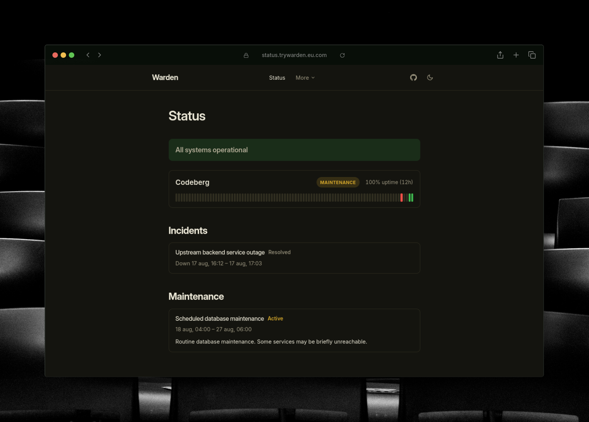

# 🧿 Warden

[](LICENSE)
[](https://github.com/hawkinslabdev/warden/commits/main)
[](https://github.com/hawkinslabdev/warden/pkgs/container/warden)

Warden is a self-hosted status page. It checks each target on a fixed interval and stores the results in a local database. The status page reports uptime, downtime and incidents from that database. Warden requires no external service.

<div>
      <p align="center"><strong>🔍 <a href="https://hawkinslabdev.github.io/warden/">See it in action!</a></strong></p>
</div>



## How it works

Your site content is defined in `content/`:

```
content/
  incidents/    incident and maintenance reports, linked to your monitors
  pages/        standalone pages like About, served at /about
  config.json   optional site settings
  locale/en.json    locale overrides (single language)
```

The status page is served at `/` and is rendered from the check history. Every other page (`/about`, `/guide`, anything in `content/pages/`) is a Markdown file with front matter:

```markdown
---
title: About
description: Which services this status page reports on.
---

Outages are reported here as they happen.
```

Warden watches `content/` and rebuilds the site in memory on every file change. Saved pages are served without a restart or build step.

## Installation

### Docker

```bash
mkdir -p warden/content warden/data && cd warden
curl -O https://raw.githubusercontent.com/hawkinslabdev/warden/main/docker-compose.yml
curl -o content/config.json https://raw.githubusercontent.com/hawkinslabdev/warden/main/content/config.example.json
chown -R 1654:1654 data
docker compose up -d
```

The site is served at `http://localhost:8080`. `content/config.json` defines the checked targets and reloads on save.

`content/` contains the pages and `config.json`. `data/` contains the check history and admin session keys. Both directories are bind mounts and persist across container rebuilds. The container runs as user `1654`. If `data/` is not writable by user `1654`: startup exits and prints the required `chown` command. SELinux hosts require `:Z` on the `data` volume.

A public host requires `PublicBaseUrl` and `AllowedHosts` in `docker-compose.yml`, set to the public origin. [Environment variables](content/pages/deploy/environment.md) lists all other settings, including the admin panel.

### Windows and IIS

Each release includes a ready-to-run Windows build:

1. Download the latest `*-Windows_x64.zip` from the [Releases](https://github.com/hawkinslabdev/warden/releases) page.
2. Extract it into your site folder, for example `C:\inetpub\warden`.
3. Create an IIS site pointed at that folder, with the CLR version set to "No Managed Code".
4. Install the [.NET 11 Hosting Bundle](https://dotnet.microsoft.com/download/dotnet/11.0).
5. Start the site and browse to it.

The zip includes a `web.config` for in-process hosting. Each release also includes a `*-Linux_x64.zip`.

## Incidents and pages

- Status page at `/`: a verdict banner, per-monitor state (operational, degraded, down, maintenance), a history bar (`historyDays`, default 90) and uptime over the same window. The page refreshes every check interval.
- Incidents and maintenance windows from `content/incidents/`, each a Markdown file with its own page
- Standalone pages from `content/pages/`
- `/sitemap.xml` and `/robots.txt`
- Atom feed of incidents and maintenance at `/incidents/feed.xml`
- JSON status at `/api/status`
- Four themes (`default`, `solarized`, `midnight`, `oled`), each with light and dark modes

Incident `start` and `end` dates are ISO 8601. `2026-09-01T02:00:00Z` is UTC, `2026-09-01T04:00:00+02:00` uses that offset, and a plain `2026-09-01 04:00` is local time in the container's `TZ`.

Incidents and standalone pages share one Markdown renderer with support for diagrams, math and footnotes. The [Markdown examples page](content/pages/examples/markdown.md) lists each syntax with its output. The [Markdown Guide](https://www.markdownguide.org/) documents the basics.

## Configuring your site

`content/config.json` is optional. It defines the site title, description, social links and monitor targets:

```json
{
  "title": "Warden",
  "description": "Uptime, downtime and outage reporting for Example Corp.",
  "socialLinks": [
    { "icon": "github", "url": "https://github.com/you" }
  ],
  "monitoring": {
    "intervalSeconds": 60,
    "retentionDays": 90,
    "targets": [
      { "id": "forgejo", "name": "Forgejo", "url": "https://forgejo.org" }
    ]
  }
}
```

A monitor `id` is the storage key for its check history and the reference used by incidents. Renaming an `id` resets that monitor's history. `retentionDays` has a minimum of `historyDays`. Changes to `monitoring` apply on the next check without a restart. An unreachable target has the status Down.

The [config.json reference](content/pages/examples/config.md) lists every field. `lang` selects the locale file `content/locale/<lang>.json`. Each key in the locale file overrides the matching interface string.

The [Git sync reference](content/pages/examples/git.md) documents syncing `content/` from a Git remote, including private repositories. Warden runs `git pull` in `content/`. In a compose `environment:` list, `GIT_CRON` takes no quotes: `- GIT_CRON=*/5 * * * *`. Quotes become part of the value.

## License

Licensed under EUPL 1.2. See [LICENSE](LICENSE).
